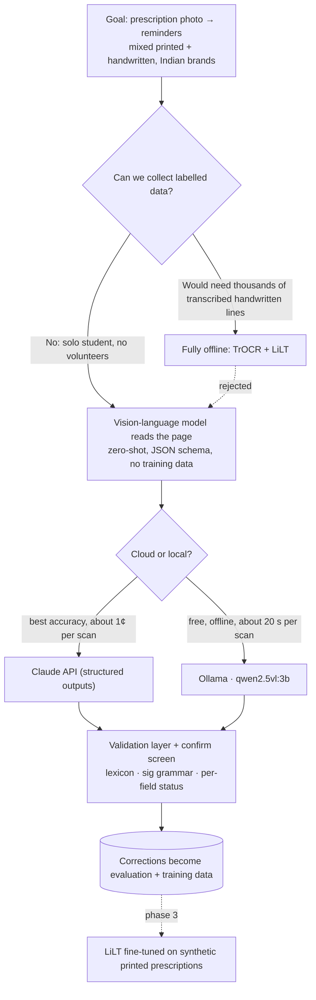
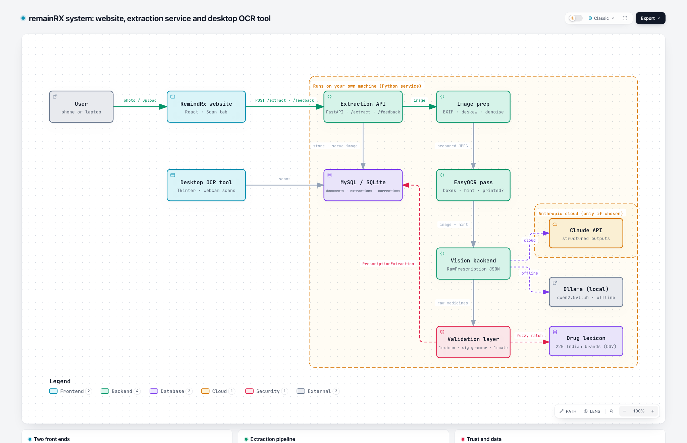
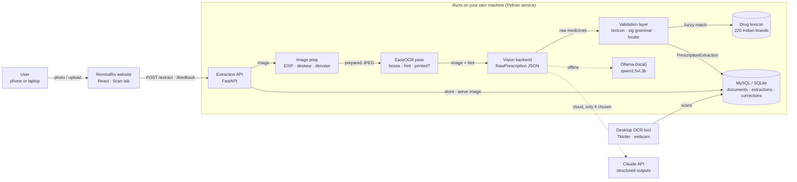
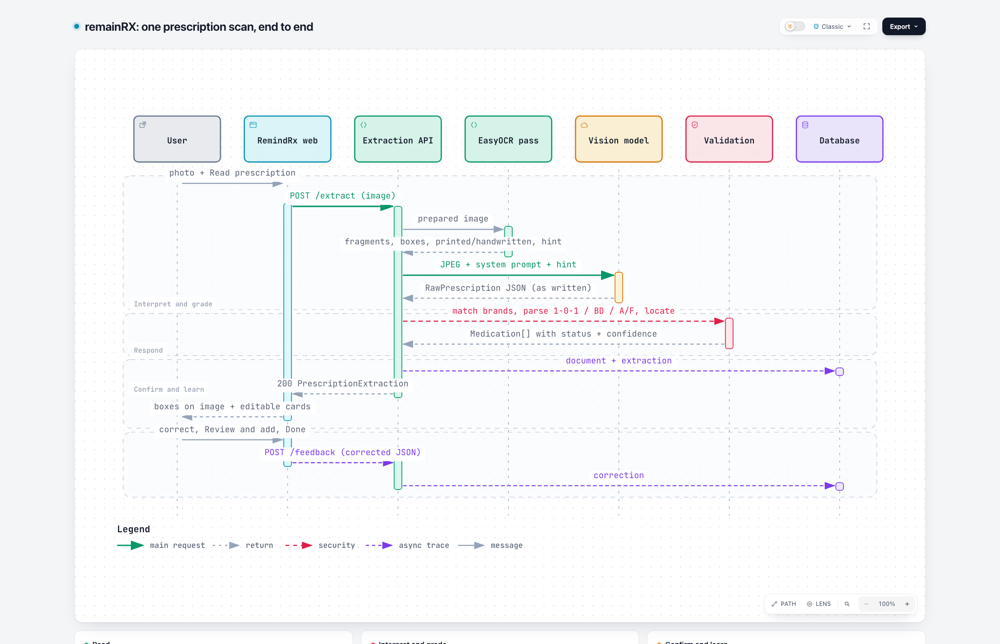
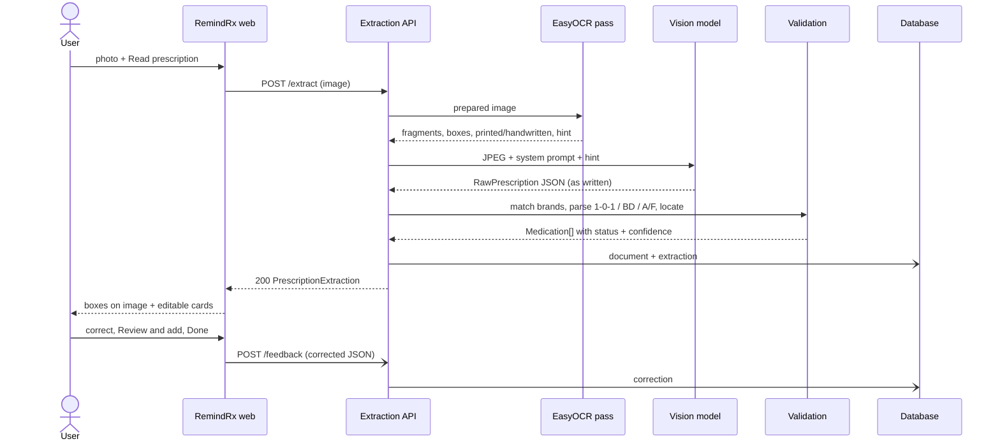
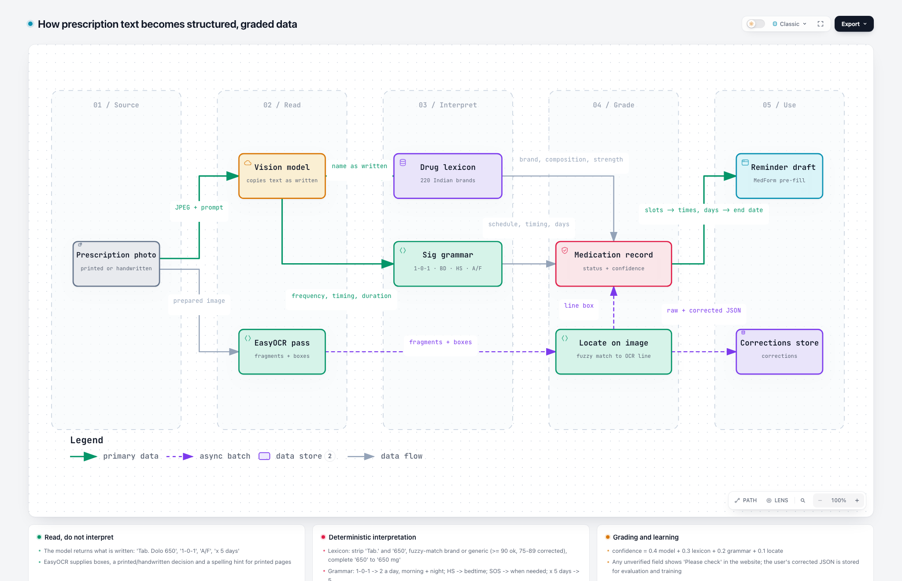
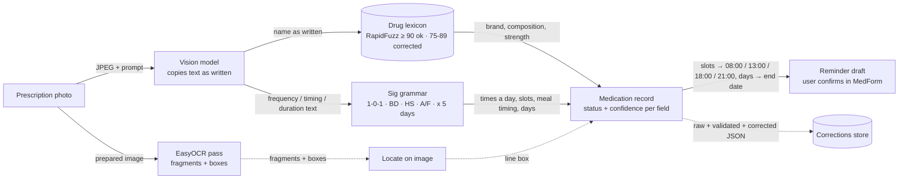

# remainRX Prescription Scanning - Project Report

**Repository:** `Ocr-Scan` · **Author:** Sunny Gupta (with Claude as engineering pair) · **Period:** 20 September - 21 October 2026

This report explains what was built, why this path was chosen over the alternatives, how the
system is designed, how a prescription travels from a photo to a medicine reminder, and how the
extracted text is turned into structured, validated data. It is written so that a reader who
has not seen the code can follow the reasoning and verify the claims.

---

## 1. Overview

Two deliverables live in this repository:

| Deliverable | What it is | Status |
|---|---|---|
| **OCR Data Scanning Tool** (`main.py`, `gui/`, `core/`) | A Tkinter desktop app: live webcam feed, EasyOCR text detection with on-screen boxes, on-demand scans saved to MySQL (SQLite fallback), history, search, export, charts | Complete; 119 tests; acceptance-run on a real camera |
| **remainRX prescription extraction** (`core/prescription*`, `core/extractors/`, `service/`, `web/`) | A FastAPI service that reads an Indian prescription image (printed or handwritten) with a vision-language model, validates the result against a drug lexicon and a dosing-shorthand grammar, and returns medicines ready to pre-fill reminders; plus the *Scan* tab in the RemindRx website | Phase 1 complete; 390 tests; verified live with a local model |

The desktop tool came first as a general real-time OCR project. The product goal that emerged
afterwards, **remainRX** (a website where a user scans their prescription and reminders are set
up quickly), reused its OCR, database and imaging layers and added the extraction service.

---

## 2. The problem and the constraints

A prescription in India is typically a mix of printed and handwritten text in English with
Indian brand names ("Dolo 650", "Azithral 500") and a compact dosing shorthand:
`1-0-1` (morning-afternoon-night counts), `OD / BD / TDS / QID`, `HS` (bedtime), `SOS` (when
needed), `A/F` / `B/F` (after / before food), `x 5 days`. A reminder needs, per medicine: the
name, the strength, how much per dose, how many times a day and when, the relation to meals,
and for how many days.

Constraints that shaped every decision:

- **Handwriting** on a large share of prescriptions, which generic OCR reads poorly.
- **No labelled data** and **no way to run a data-collection campaign** (solo student, no access
  to doctors, pharmacists or volunteers).
- **Tiny budget**, and a wish for an offline mode.
- **Safety**: a wrong dose or frequency in a reminder can harm someone, so the system must
  never create reminders silently.

---

## 3. Research: the options considered and what we found

Seven approaches to "key-value extraction from a prescription" were evaluated before writing
code.

| # | Approach | Training data needed | Handles new layouts | Offline | Verdict |
|---|---|---|---|---|---|
| 1 | Rule-based pairing (regex on `key: value`, nearest-box geometry) | none | low | yes | kept as the **validation layer**, not as the reader |
| 2 | Template / zonal OCR for fixed forms | none | none | yes | not applicable: prescriptions vary |
| 3 | CRF / spaCy sequence labelling on OCR text | hundreds of fragments | low | yes | weak on tables and handwriting |
| 4 | Layout-aware transformer (LiLT, LayoutLMv3, BROS) fine-tuned for token tagging + relation extraction | 100-500 annotated documents | medium | yes | **deferred to phase 3**, trained on synthetic printed data only |
| 5 | OCR-free document models (Donut, Pix2Struct) | 500+ documents | medium | yes | heavier, slower on CPU, more data |
| 6 | Vision-language model, zero-shot with a JSON schema | none | high | only with a local open model | **chosen** |
| 7 | PaddleOCR PP-Structure KIE | fine-tuning for English | medium | yes | painful install on Apple Silicon, Chinese-centric pre-training |

Findings that decided the path:

1. **Handwriting rules out "OCR then tag".** EasyOCR's detector finds the text lines on
   handwritten pages, but its recogniser mis-reads them; a layout model can only tag what the
   OCR read. The "fully offline" variant (fine-tune TrOCR on doctor handwriting, then LiLT)
   needs thousands of transcribed handwritten lines; that collection campaign was the one
   thing the project could not do, so the path was rejected after being designed in detail.
2. **A vision-language model needs no labelled data and reads handwriting far better.**
   Claude (structured outputs) gives the strongest result; an open model through Ollama gives a
   free, offline alternative. Both were kept behind one interface, switchable in `.env`.
3. **The model is not trusted alone.** Its output is validated by a drug lexicon and a
   dosing grammar, graded per field, and shown to the user beside the highlighted image for
   confirmation. Corrections are stored and become the training set that approaches 4 and 5
   would otherwise require up front.
4. **The public dataset that looked promising did not fit.** `paraloq/json_data_extraction`
   is synthetic, text-only (no images or boxes), has only a handful of prescription-shaped rows
   and a research-only note; it was useful only as schema inspiration.
5. **Live testing changed the local model.** The planned `qwen3-vl:4b` never produced JSON under
   Ollama's schema-constrained output: it reasons until the token budget is exhausted and
   returns empty content (`done_reason=length`) even with thinking disabled and a larger
   context. The non-reasoning `qwen2.5vl:3b` answers correctly in about 20 seconds. Details in
   section 8.

### 3.1 The decision path, visually



---

## 4. Decisions and their reasons

1. **Vision-model-first, rules second.** No labelling campaign; best handwriting coverage;
   rules make the output trustworthy and measurable.
2. **Two backends, one interface, no silent fallback.** `EXTRACTOR_BACKEND=claude` (default
   `claude-opus-5-5`, about one cent per prescription) or `EXTRACTOR_BACKEND=ollama`
   (`qwen2.5vl:3b`, free, offline). A failing backend is reported, never swapped, so cost and
   privacy expectations never change without the user knowing.
3. **Raw text in, structured data out.** The model copies what is written (`frequency_text`
   "1-0-1", `timing_text` "A/F"); our grammar converts it. Models are good at reading, less
   reliable at interpreting shorthand consistently.
4. **Per-field status and confidence.** Every field is `ok`, `corrected` (we changed it, the
   original is kept in `warnings`) or `unverified`. Confidence is composed from validation
   signals, not taken from the model alone.
5. **Confirmation before reminders.** The website shows each medicine beside its box, flags
   anything `unverified`, and saves only after the user presses Done in the existing form.
6. **Corrections are data.** `documents`, `extractions` and `corrections` tables record every
   run and every user edit, giving a growing evaluation and training set for free.
7. **Option 4 (LiLT) stays as phase 3**, trained purely on synthetic printed prescriptions, to
   be compared against the vision backends on the printed share.
8. **The extraction runs as a server-side API** the website calls; the desktop app becomes
   the annotation and correction tool (planned for phase 2).

---

## 5. Architecture



*Interactive version with hover, search and export: [`docs/diagrams/architecture.html`](diagrams/architecture.html). Green arrows are the main request path, dashed violet arrows the backend choice, dashed red the validated result returning to storage.*



Layers and responsibilities:

| Layer | Modules | Responsibility |
|---|---|---|
| `config/` | `settings.py` | Typed settings from `.env` with validation and safe defaults |
| `core/` (OCR tool) | `camera.py`, `ocr_engine.py`, `ocr_worker.py`, `detector.py`, `scan_pipeline.py`, `audio.py` | Threaded capture, lazy EasyOCR, single inference thread, preprocessing and overlays, the six-step scan |
| `core/` (remainRX) | `prescription.py`, `imaging.py`, `extractors/`, `sig_grammar.py`, `drug_lexicon.py`, `locate.py`, `prescription_pipeline.py` | Schema, image prep, vision backends, shorthand parser, brand matching, box localisation, the extraction pipeline |
| `database/` | `models.py`, `mysql_repository.py`, `sqlite_repository.py`, `prescription_repository.py`, `db_manager.py` | Repository interfaces, two implementations each, MySQL → SQLite fallback |
| `service/` | `api.py`, `__main__.py` | HTTP API, CORS, lifespan (OCR warm-up thread), error mapping |
| `gui/` | `app.py`, panels, views | Desktop UI; Tk touched only from the main thread via a queue |
| `web/` | `src/screens/ScanPrescription.tsx`, `src/api/extract.ts`, `src/lib/prescriptionToDraft.ts` | Scan tab, typed client, mapping into the website's medication model |

Threading model of the desktop tool: the camera thread fills a two-slot queue (newest frame
wins); one OCR worker thread serialises live preview and scan inference (live frames are dropped
while busy, scans are queued); the Tk thread drains a callable queue every 30 ms. On macOS the
camera is opened on the main thread because AVFoundation shows its permission prompt only there,
a bug found during the acceptance run.

---

## 6. Technology

| Area | Choice | Why |
|---|---|---|
| Language | Python 3.12 (uv-managed venv), TypeScript for the website | Required stack; Homebrew Python on this Mac has a broken `pyexpat` |
| OCR | EasyOCR 1.7 (CRAFT detector + CRNN recogniser), CPU | Required; detector is useful on handwriting even when recognition is not |
| Vision models | Claude API via `anthropic` SDK (`messages.parse`, Pydantic structured outputs); Ollama via `ollama` SDK (`format=<JSON schema>`, temperature 0) | Best accuracy vs free offline |
| Validation | RapidFuzz (fuzzy brand matching), hand-written grammar (regex tables) | Deterministic, testable, fast |
| Schema | Pydantic v2 | One schema drives both backends and the API |
| API | FastAPI + uvicorn | Thin, typed, Swagger UI for free |
| Storage | MySQL 8.4 (connector pool) with SQLite fallback | Required; offline mode must never crash |
| Desktop UI | Tkinter/ttk, Pillow, matplotlib (TkAgg), pygame | Required stack |
| Website | React 19, Vite, Tailwind, lucide icons, localStorage PWA | Existing RemindRx app |
| Quality | pytest + pytest-mock (390 tests), ruff, compileall, opt-in live tests | Nothing claimed without a passing command |

---

## 7. End-to-end flow



*Interactive version: [`docs/diagrams/sequence-end-to-end.html`](diagrams/sequence-end-to-end.html).*



The same flow in words:

1. **User** opens the Scan tab, takes a photo or chooses an image, picks a backend if both are
   configured, presses *Read prescription*.
2. **Website** posts the image to `POST /extract` (multipart). The service checks the backend
   is ready (`503` with the exact fix otherwise, e.g. "Run: ollama pull qwen2.5vl:3b").
3. **Imaging**: the file is decoded, rotated by EXIF, downscaled so the longest side is 1600 px,
   deskewed (projection-profile method, up to ±15°) and lightly denoised.
4. **EasyOCR pass** on the prepared image gives text fragments with boxes. If the mean
   confidence is under 0.45 or fewer than four fragments were found, the page is marked
   *handwritten*. For printed pages the fragments, sorted into reading order, become an
   **OCR hint** sent to the model to anchor spellings.
5. **Vision backend**: the JPEG, a fixed system prompt describing Indian conventions, and the
   optional hint go to Claude or Ollama. Both must return a `RawPrescription`: patient, doctor,
   date, notes and one `RawMedication` per line with the text copied as written
   (`name`, `strength`, `form`, `dose`, `frequency_text`, `timing_text`, `duration_text`,
   `instructions`, model `confidence`).
6. **Validation** (section 8) turns each raw medication into a `Medication` with normalised
   values, lexicon match, parsed schedule, per-field status, confidence and a box.
7. **Persistence**: the processed JPEG is stored as `data/documents/<id>.jpg`, the raw model
   output and the validated result go to `extractions`, and the response carries
   `document_id`.
8. **Website** renders the processed image (from `GET /documents/{id}/image`, so the boxes line
   up exactly) with one coloured box per medicine, and an editable card per medicine.
9. **User** corrects anything flagged and presses *Review and add*; the existing Add
   Medication form opens pre-filled; only *Done* saves a reminder.
10. **Feedback**: the corrected extraction is posted to `POST /feedback` and stored in
    `corrections`, linked to the document, for evaluation and future training.

Example response (abridged, real output of the local model on the handwriting-style sample):

```json
{
  "document_id": 12, "patient_name": "Suman", "doctor_name": "Dr. S. Mehta", "handwritten": false,
  "backend": "ollama", "model": "qwen2.5vl:3b", "processing_ms": 14089,
  "medications": [
    {"name": "Dolo", "brand_matched": "Dolo", "composition": "Paracetamol", "strength": "650 mg",
     "frequency_text": "1-0-1", "frequency": {"pattern": "1-0-1", "times_per_day": 2, "slots": ["morning", "night"], "as_needed": false},
     "timing": "after_food", "duration_days": 5, "status": "ok", "confidence": 0.96,
     "field_status": {"name": "ok", "strength": "ok", "frequency": "ok", "timing": "ok", "duration": "ok"},
     "bbox": [[80, 310], [800, 310], [800, 345], [80, 345]]},
    {"name": "Levocet", "composition": "Levocetirizine", "strength": "5 mg",
     "frequency": {"pattern": "0-0-1", "times_per_day": 1, "slots": ["night"]}, "timing": "bedtime", "duration_days": 5, "status": "ok"}
  ],
  "warnings": []
}
```

---

## 8. How the extracted text is arranged into structured data

The model reads; the code interprets. This separation is what makes results checkable.



*Interactive version: [`docs/diagrams/dataflow-structuring.html`](diagrams/dataflow-structuring.html).*



### 8.1 Two schemas

- `RawPrescription` / `RawMedication` - exactly what is written on the page, verbatim strings,
  nulls when absent. Both backends are constrained to this JSON schema (Claude through
  `output_format`, Ollama through `format`).
- `PrescriptionExtraction` / `Medication` - the API response: the raw fields plus
  `brand_matched`, `composition`, a normalised `strength`, a `Frequency` object
  (`pattern`, `times_per_day`, `slots`, `interval_hours`, `as_needed`), `timing`,
  `duration_days`, `status`, `field_status`, `confidence`, `bbox`, and document-level
  `warnings`.

### 8.2 Drug lexicon (`data/drug_lexicon_in.csv`, `core/drug_lexicon.py`)

220 common Indian brands with composition, strengths and form (a seed list marked
`seed-verify`; it must be reviewed by a pharmacist before production and grows from
corrections). Matching: the name is normalised (dosage-form prefix such as "Tab." and strength
tokens such as "650" stripped), then compared with RapidFuzz `WRatio` against brand names and
against each component of every composition.

| Score | Status | Effect |
|---|---|---|
| ≥ 90 | `ok` | brand and composition filled in |
| 75 - 89 | `corrected` | name replaced by the lexicon brand (or generic interpreted), original kept in `warnings` |
| < 75 | `unverified` | user must confirm |

A bare numeric strength written by the model ("650") is completed from the lexicon ("650 mg")
when exactly one listed strength matches.

### 8.3 Sig grammar (`core/sig_grammar.py`, 180 table-driven tests)

| Written | Parsed |
|---|---|
| `1-0-1`, `1-1-1`, `0-0-1`, `1/2-0-1/2`, `1-0-0-1` | `pattern`, `times_per_day` = non-zero count, `slots` by position (3- or 4-slot), fractional entries become the dose |
| `OD`, `once daily` / `BD`, `twice` / `TDS`, `TID`, `thrice` / `QID` | 1 / 2 / 3 / 4 times with default slots |
| `HS`, `at bedtime`, `nocte` | once at night, timing `bedtime` |
| `SOS`, `PRN`, `when required` | `as_needed = true` |
| `q8h`, `every 6 hours`, `8 hourly` | `interval_hours`, `times_per_day = 24 / h` |
| `A/F`, `after food`, `PC` / `B/F`, `before food`, `AC` / `with food` / `empty stomach` | `timing` |
| `x 5 days`, `5 days`, `2 weeks`, `1 month`, `5/7` | `duration_days` (1-365) |
| `Tab.`, `Cap`, `Syp`, `Inj`, `Oint`, `Drops`, `Inh`, `Pwd` | `form`, and the prefix is stripped from the name |
| `500MG`, `5ml`, `250mcg`, `0.5%`, `100 mg/5 ml` | normalised strength |

Anything unparseable keeps the raw text and marks that field `unverified`; the grammar never
guesses.

### 8.4 Locate (`core/locate.py`)

Each medicine name is fuzzy-matched (`partial_ratio ≥ 80`) against the EasyOCR fragments; the
box returned is the union of every fragment on the same text line (vertical overlap ≥ 50 %), so
the website highlights the whole prescription line.

### 8.5 Confidence and status

`confidence = 0.4 · model + 0.3 · lexicon score + 0.2 · grammar success + 0.1 · locate score`.
A medicine is `unverified` if any field is, `corrected` if any field was changed, else `ok`.
Document-level `warnings` explain every correction and every unparsed value in plain language.

### 8.6 Into the website's medication model (`web/src/lib/prescriptionToDraft.ts`)

Slots become default times (morning 08:00, afternoon 13:00, evening 18:00, night 21:00; an
interval schedule is spread evenly); `times_per_day > 1` becomes the multi-daily frequency;
`duration_days` sets the end date from today; meal timing maps to before / with / after / any;
`as_needed` disables reminders; the dose string gives the quantity and unit ("5 ml" → 5 ML,
"1/2" → 0.5 tablet). The user still sees and confirms every value in the form.

---

## 9. Methodology

- **Spec → plan → test-first implementation.** Each piece started from a written spec
  (`docs/superpowers/specs/`) and plan (`docs/superpowers/plans/`); every module's tests were
  written and watched to fail before the code existed.
- **No network in the default test suite.** Backends are tested with fake clients and recorded
  responses; real calls run only under `pytest -m live`.
- **Evidence before claims.** Every "it works" in this repository is backed by a command whose
  output was read: 390 tests, ruff, compileall, live runs, a real server smoke test.
- **Systematic debugging instead of guessing.** The Ollama failure is the case study: the
  symptom was empty output. Three hypotheses were tested one variable at a time
  (disable thinking → no; larger context → no; the token arithmetic `prompt + generated = 4096`
  then `= num_predict` showed the model reasons until any budget is exhausted) before the model
  was swapped. The fixes that did hold (context window 8192, capability-guarded `think` flag,
  distinct token-limit error) are each covered by a test that fails without them.
- **Honest reporting.** The handwriting-style sample is font-rendered, so real doctor
  handwriting is still unmeasured; Claude was not live-tested on this machine (no key); the
  website build is blocked on a `shared/` module that lives outside the repository.

---

## 10. Verification status

| Check | Result |
|---|---|
| `pytest -q` | 390 passed (SQLite, MySQL 8.4 in Docker, real EasyOCR; fake-client backend tests) |
| `ruff check`, `ruff format --check`, `compileall`, `pip check` | clean |
| `pytest -m live` (Ollama `qwen2.5vl:3b`) | 2 passed: printed sample 3/3 medicines, handwriting-style sample 4/4, all fields `ok`, 14-25 s per image |
| `pytest -m live` (Claude) | skipped on the dev machine (no `ANTHROPIC_API_KEY`) |
| Real service | `/health` ok, CORS from the Vite origin confirmed, error paths return the intended 422/502/503 |
| Desktop tool | acceptance-run on the MacBook camera and with synthetic frames into MySQL |

---

## 11. Known limitations and risks

- Real handwriting accuracy is unmeasured until real photos are tested.
- The lexicon is a seed list; unknown brands become `unverified`.
- The local model is slow without a GPU (about 20 s per image) and weaker than Claude on messy
  pages; Claude costs money and sends images to a cloud API (consent and a data-processing
  agreement are required for health data).
- HEIC photos from iPhones are not decoded; browsers usually convert them on upload.
- The website needs the external `shared/` module to build.

---

## 12. What comes next

- **Phase 2**: Prescription mode in the desktop app (upload, review, correct, export), a gold set
  of 30-50 real prescriptions with hand-checked JSON, `training/evaluate.py` reporting per-field
  accuracy and the "whole schedule correct" rate, shown in the Stats window.
- **Phase 3**: synthetic printed-prescription generator, LiLT fine-tune on Colab, comparison
  against both vision backends on the printed share.
- **Ongoing**: corrections retrain and extend the lexicon.

---

## 13. How to run

```bash
# service (from the repository root; backend and model come from .env)
.venv/bin/python -m service --port 8765        # http://127.0.0.1:8765/docs
curl -s -F "image=@tests/fixtures/sample_rx.jpg" http://127.0.0.1:8765/extract | python -m json.tool

# website (needs shared/ next to web/)
cd web && cp .env.example .env && npm install && npm run dev   # http://localhost:5175 → Scan

# desktop OCR tool
python main.py

# tests
pytest -q                 # 390 tests, no network
pytest -m live -s tests/test_live_backends.py
```

## 14. Repository map

```
main.py gui/ core/{camera,ocr_engine,ocr_worker,detector,scan_pipeline,audio}.py   # desktop OCR tool
core/{prescription,imaging,sig_grammar,drug_lexicon,locate,prescription_pipeline}.py
core/extractors/{base,prompt,claude,ollama}.py                                      # vision backends
service/{api,__main__}.py                                                          # FastAPI
database/{models,mysql_repository,sqlite_repository,prescription_repository,db_manager}.py schema.sql
data/drug_lexicon_in.csv                                                           # 220 Indian brands
web/src/screens/ScanPrescription.tsx web/src/api/extract.ts web/src/lib/prescriptionToDraft.ts
tests/ (21 files, 390 tests)   notebooks/demo.ipynb   docs/superpowers/{specs,plans}/   CHANGELOG.md
```
